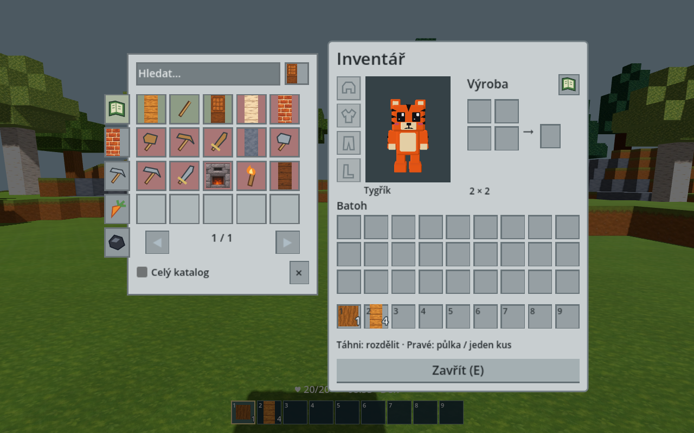
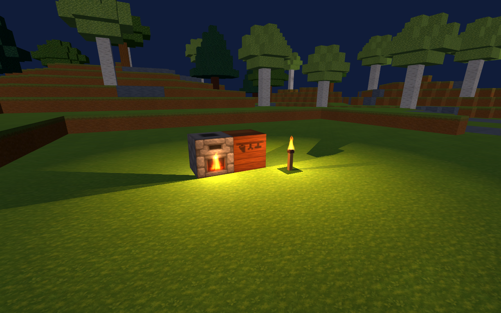

# JOSCRAFT 0.4.3

## Návod pro Codex na novém počítači

Pro vývoj na Windows nainstaluj Git, **Godot 4.7.2 .NET (Mono)** a **.NET SDK**. Ověřené lokální SDK je **10.0.401**, projekt cílí na `net8.0`. Windows skripty očekávají `C:\Program Files\dotnet\dotnet.exe` a obě Godot aplikace v PATH: `Godot_v4.7.2-stable_mono_win64.exe` a `Godot_v4.7.2-stable_mono_win64_console.exe`. Do PATH přidej adresář s rozbaleným Godotem.

Z kořene klonu použij v PowerShellu:

```powershell
New-Item -ItemType Directory -Path artifacts -Force | Out-Null
dotnet --list-sdks
dotnet build .\Joscraft.csproj
Godot_v4.7.2-stable_mono_win64_console.exe --headless --editor --path . --import --quit
powershell -ExecutionPolicy Bypass -File tools/verify_building.ps1
```

Hru spustíš pomocí `SPUSTIT_JOSCRAFT.vbs`. Pro změny v přežití spusť `tools/verify_survival.ps1`, pro lokální multiplayer `tools/verify_net.ps1`. Výstupy kontrol vznikají v `artifacts/`. Uložené světy ve vývojovém projektu jsou v ignorovaném `saves/`.

Blender a Python instaluj při úpravě modelů a textur. Skripty s `bpy` spouštěj Blenderem; pro `tools/prepare_survival_assets.py` nainstaluj Pillow do Python prostředí. Pro Windows export připrav odpovídající .NET exportní šablony Godotu a použij `tools/package_release.ps1`. Další požadavky popisují [mobilní export](docs/mobile-export.md) a [vydávání aktualizací](docs/automatic-updates.md).

Vlastní bloková survival hra v Godotu4.7.2 Mono / C#. Jeden malý seedovaný svět,11hratelných postaviček, těžba a stavění, výroba a první společné hraní po LAN. Výchozí pohled je z první osoby.

## Spuštění

Vývojový projekt: `SPUSTIT_JOSCRAFT.vbs` (potřebuje místní Godot Mono a .NET SDK). Běžící starší hru nejprve ulož a zavři; nebyla automaticky ukončena.

Samostatný Windows balíček: rozbal celou složku z `build/JosCraft-windows-x64.zip` a spusť `JosCraft.vbs`. Má vlastní runtime. Uložené světy jsou v uživatelských datech Godotu/JOSCRAFT/saves a při výměně herní verze zůstávají oddělené. Vývojový projekt dál používá vlastní `saves/`.

## Ovládání

WASD pohyb, mezerník skok, Ctrl běh, Shift opatrná chůze u hrany. Drž levé tlačítko pro těžbu; na zombie levým útoč. Pravé tlačítko použije pracovní stůl/pec/truhlu, otevře dveře, nakrmí nebo přepne zvíře, jinak položí vybraný blok. Prostřední vybere již vlastněný materiál. E otevře batoh,1–9/kolečko vybírá rychlou lištu, F5/V přepne pohled. Esc pauza. Dotykové ovládání má samostatná tlačítka; fyzický tablet zatím nebyl ověřený.

Zásobu vezmi myší. Držení a tažení přes sloty ukáže rovnoměrné rozdělení (4kusy přes3sloty =1+1+2), puštění ho potvrdí. Pravým klikem vezmi polovinu nebo polož1kus. Zásoby se při zavření bezpečně vrátí; co se nevejde, hra nesmaže.

## Výroba a receptář

Kmen →4prkna;2prkna nad sebou →4klacíky;4prkna ve čtverci →pracovní stůl. Pravým tlačítkem na položený stůl otevřeš3×3. Vyrob dřevěný krumpáč, vytěž dlažební kámen a z8kusů kolem prázdného středu vyrob pec. Jíl dává4hroudy, pec je vypálí na cihly;4cihly tvoří stavební blok. Uhlí nebo dřevěné uhlí nad klacíkem →4pochodně. Kmeny v peci dávají dřevěné uhlí. Přímé1kmen →4klacíky je navíc výslovně uživatelem zvolený recept JOSCRAFT, volitelný proti prknům.

Zelená knížka otevře receptář vedle inventáře: kategorie, hledání, mřížka5×4, stránkování a filtr vyrobitelných. Kliknutí na podporovaný crafting recept vloží skutečně vlastněné suroviny; chybějící složení ukáže červený průsvitný vzor. `Celý katalog` přidá recepty s materiály/stanicemi, které teprve doplníme. Na malém displeji se kniha otevře samostatně.

Katalog obsahuje1892normalizovaných receptů z připnutých oficiálních Bedrock dat Mojangu. Hra vyrábí pouze recepty se skutečně zavedenými materiály a stanicemi. Nejde o hotovou kompletní sadu Minecraft bloků: další práci řídí `docs/material-roadmap.csv` (1312materiálových ID a značek). Podklady a přesný zdrojový commit: `docs/recipe-catalog.md`.

Dubové desky, schody, dveře, ploty a truhlu lze vyrábět ve stole 3×3 a stavět. Dveře jsou 1 blok široké a 2 vysoké; pravé tlačítko je otevře nebo zavře. Truhla má 27 ukládaných slotů a animované víko. Obsazená truhla se nedá vytěžit; při otevírání musí mít místo nad sebou a za sebou. Podrobnosti a recepty: `docs/building-v0.4.1.md`.

Postavičky mají herní výšku přibližně 1,85 bloku a pohled ve výšce 1,61 bloku. Modely používají stejné měřítko ve všech osách, takže si zachovávají původní proporce. Průchod dveřmi řeší herní kolizní tělo široké 0,6 bloku; dekorativní části jeho šířku nezvětšují. Ateliér a původní GLB zůstávají beze změn. Podrobnosti: `docs/player-sizing-v0.4.3.md`.

## Svět a společníci

Svět má zatím pevné hranice 96×96 bloků; streamování okolí ještě není nekonečné generování. Duby, břízy, smrky; jednotlivé kmeny dávají fyzické kusy dřeva. Listí bez podpory postupně mizí. Tráva při těžbě dává hlínu, odkrytá položená hlína postupně zaroste. Povrchová modrošedá ložiska jílu a podzemní uhelná ruda.

Den/noc má20minutový cyklus. V noci až3zombie, boj a zdraví; na slunci zombie slábnou. Pec a pochodně mají animovaný oheň a skutečné teplé světlo. Pochodeň se zatím staví na horní pevný povrch. Nejvýše6nejbližších světel aktivně osvětluje scénu.

Pes: kost ze zombie; zajíc: mrkev; liška: bobule. Krmení vyber v liště a klikni pravým. Ochočené zvíře následuje vlastníka, dalším pravým klikem čeká. Mrkev a bobule sklízej z malých porostů pravým tlačítkem. Kočičí model je zvlášť připravený v `source/cat-companion`; herní kočka ještě není zapojená.

## Hrát spolu a aktualizace

Menu `Hrát spolu (LAN)`: PC hostuje nový nebo uložený svět, ostatní zadají jeho adresu a port24567. Nejvýše4hráči, společný svět, oddělené batohy, uložení jen u hostitele. Pauza hostitele ostatní nezastaví. Ověřené jsou samostatné procesy na jednom PC; fyzické druhé zařízení, internet/rocketweb.cz a NAT propojení ještě nejsou ověřené ani nasazené.

Samostatná vydaná Windows hra kontroluje nové stabilní GitHub Releases, stahuje na pozadí a po uložení přejde přes krátký restart do nové verze. Zachovává předchozí verzi a při selhání se vrátí. Vývojové zdroje sama nepřepisuje. Podrobnosti: `docs/automatic-updates.md`. Vydání vyžaduje ZIP a `update.json` v GitHub Release; samotný push kódu není aktualizace.

## Ověření a zdroje

`tools/verify_building.ps1`, `tools/verify_survival.ps1`, `tools/verify_net.ps1`, `tools/package_release.ps1`, `tools/verify_updater.ps1`. Aktuální reporty, skutečné screenshoty a SHA manifest jsou v `artifacts/`; živé saves jsou z veřejných zdrojů i manifestu vyloučené. Historické reporty patří ke svým etapám.

Vlastní grafika:23terénních/stromových/výrobních textur, původní postavy a nové modely společníků. Nové atlasy vytvořil vestavěný ImageGen; přesné prompty `source/textures/prompts-survival-v1.json`, extrakce `tools/prepare_survival_assets.py`. Modely/animace společníků dodal Antigravity, návrh multiplayeru Claude; výsledná integrace a ověření proběhly v tomto projektu. Voda/láva, hlad, plná sada bloků a pokročilé pracovní stanice nejsou v této etapě hotové. Původní DetiSkola ani rodinná zařízení se neměnily.




